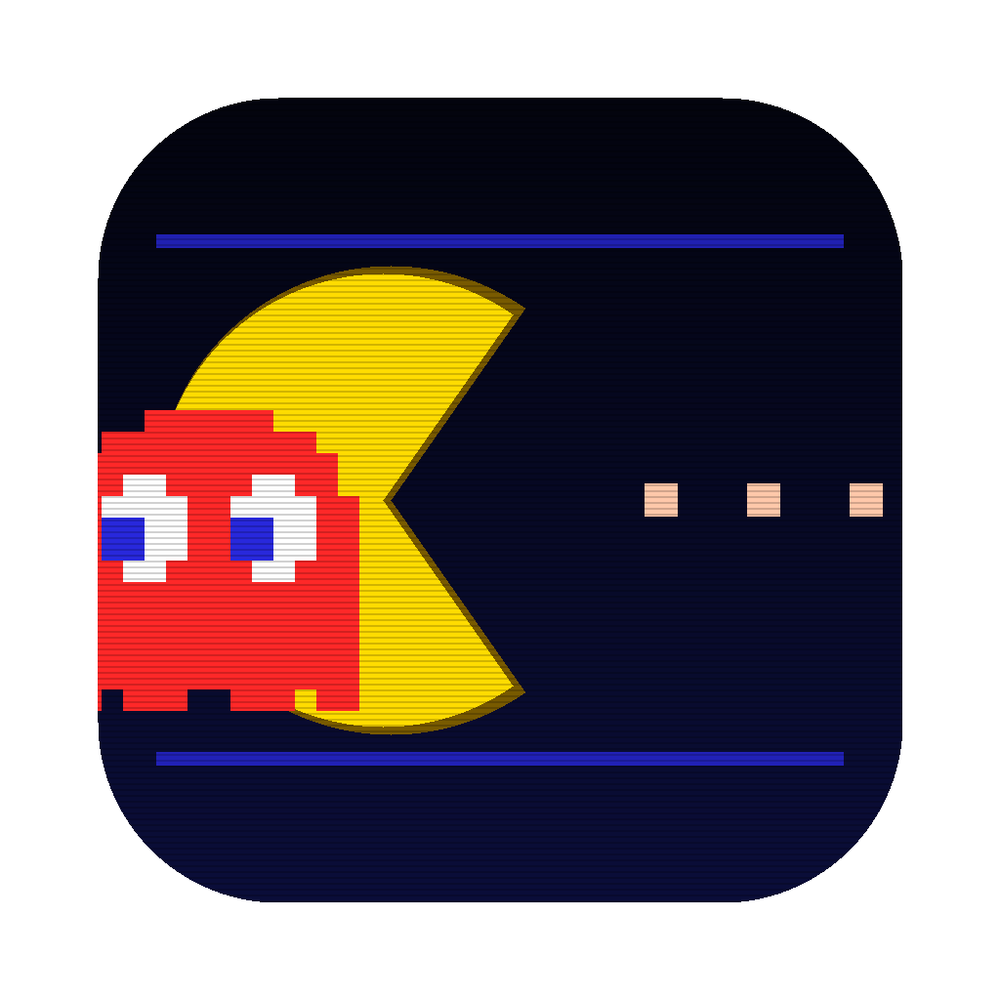

# Pac-Man

A faithful, from-scratch recreation of the 1980 arcade classic as a **native
macOS app** — Swift + SpriteKit, no external assets, no telemetry.

**[⬇ Download the latest DMG](https://github.com/vincentlauriat/PacMan/releases/latest)** ·
[Landing page](https://vincentlauriat.github.io/PacMan/)



## Faithful to the arcade

- Original **224×288** screen (rendered ×3), the exact **28×31 maze**,
  240 dots + 4 energizers, CRT scanlines.
- The four ghosts with their real personalities: **Blinky** chases,
  **Pinky** ambushes 4 tiles ahead (overflow bug included), **Inky**
  mirrors Blinky, **Clyde** is shy past 8 tiles.
- Arcade **scatter/chase** wave schedule, frightened mode with end-of-mode
  flashing, ghost-house dot counters, "Cruise Elroy" speed-ups.
- Level speed tables, tunnel slowdown, fruit at 70/170 dots
  (cherry → key), 200/400/800/1600 ghost chains, extra life at 10 000.
- Hand-made 5×7 bitmap font, code-generated 8-bit square-wave sounds
  (waka-waka, siren, frightened wobble, death).

## Controls

| Key | Action |
|---|---|
| Arrows / WASD | Steer Pac-Man |
| Space | Start game |
| P | Pause |
| M | Mute |

## Install

Download the DMG from the [releases page](https://github.com/vincentlauriat/PacMan/releases/latest),
drag **Pac-Man.app** to Applications. The app is Developer ID **signed and
notarized**, and updates itself via **Sparkle**.

## Build from source

```bash
brew install xcodegen
python3 Scripts/generate_assets.py   # 8-bit WAVs + AppIcon.icns
xcodegen generate
xcodebuild -project PacMan.xcodeproj -scheme PacMan -configuration Release build
```

## Project layout

```
Sources/            Swift sources (SpriteKit, no external deps but Sparkle)
  GameScene.swift   game loop, state machine, ghost AI
  Maze.swift        the 28x31 maze, wall rendering
  Actors.swift      ghost model & appearance
  Sprites.swift     pixel-art patterns (ghosts, fruits)
  Pixel.swift       pattern -> nearest-neighbor texture helpers
  PixelFont.swift   5x7 bitmap font
Resources/          generated AppIcon.icns + Sounds/*.wav
Scripts/            generate_assets.py, release.sh (sign + notarize + Sparkle)
docs/               landing page (GitHub Pages)
```

## License

[MIT](LICENSE). This is a free, open-source tribute written entirely from
scratch — code, pixel art and sounds. PAC-MAN is a trademark of Bandai Namco
Entertainment Inc., which is not affiliated with this project.
